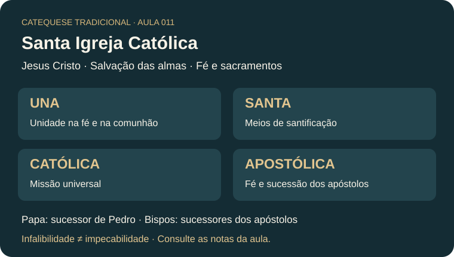

# Aula #011 — Creio na Santa Igreja Católica

**Professor:** Marco Antônio  
**Referência central:** Catecismo de São Pio X, conforme a exposição do professor  
**Origem:** transcrição enviada pelo estudante  
**Duração:** aproximadamente 1 hora; tempos abaixo são aproximados.

!!! info "Objetivo"
    Compreender a fundação e a missão da Igreja, sua hierarquia e suas quatro notas; distinguir santidade, impecabilidade, infalibilidade e decisões disciplinares.

## 1. Resumo essencial

A aula explica o artigo do Credo **“Creio na Santa Igreja Católica”**. O professor apresenta a Igreja como instituição fundada por Jesus Cristo para guardar e transmitir a Revelação e administrar os sacramentos. Sua finalidade é a **salvação das almas**.

A exposição aborda a autoridade de Pedro e de seus sucessores, os bispos como sucessores dos apóstolos e a participação dos fiéis na vida da Igreja. Distingue membros vivos, que vivem na graça, de membros mortos pelo pecado mortal: essa linguagem espiritual não significa que todo pecador tenha sido formalmente expulso da Igreja.

As quatro notas estudadas são **una, santa, católica e apostólica**. A unidade comporta diversidade de ritos católicos; a santidade não significa ausência de pecados dos membros; a catolicidade indica universalidade; a apostolicidade remete à fé e à sucessão dos apóstolos.

No encerramento, o professor distingue a infalibilidade em matéria de fé e moral de opiniões pessoais e decisões políticas. Algumas aplicações históricas e litúrgicas da exposição precisam de revisão, indicada na seção de aprofundamento.

> **Frase para memorizar:** A Igreja é una, santa, católica e apostólica; sua missão é conduzir as almas à salvação.

## 2. Estudo por blocos

### Bloco 1 — Fundação e autoridade (00:10–06:10)

Cristo confia aos apóstolos a transmissão de seus ensinamentos e a administração dos sacramentos. O professor relaciona a autoridade da Igreja à missão recebida de Cristo e à guarda do depósito da fé após o período apostólico.

**Para guardar:** a autoridade é apresentada como recebida de Cristo para servir à transmissão da fé.

### Bloco 2 — Hierarquia e membros (06:10–11:38)

O nome Igreja é explicado a partir da ideia de assembleia. A aula destaca sua origem divina e sua estrutura humana visível. O Papa, bispo de Roma, é apresentado como sucessor de Pedro; os bispos, como sucessores dos apóstolos. O professor distingue membros vivos e mortos conforme a vida da graça e aponta a Confissão como caminho de reconciliação.

**Para guardar:** distinguir a pertença à Igreja da condição espiritual de viver em estado de graça.

### Bloco 3 — Fim e meios (11:38–17:18)

A finalidade da Igreja é a salvação das almas. O ensino da fé e os sacramentos são apresentados como meios para essa missão. As obras de caridade se integram a essa finalidade. A visibilidade da Igreja é relacionada à condição humana de corpo e alma.

**Para guardar:** missão, ensinamento e vida sacramental caminham juntos.

### Bloco 4 — Santidade e organização (17:18–25:55)

A aula descreve a Igreja como visível, sobrenatural, necessária e perfeita. A expressão **sociedade perfeita** refere-se à posse dos meios necessários à sua finalidade; não torna impecáveis seus membros. O professor aborda direito canônico, organização temporal e desenvolvimento de ordens religiosas.

**Para guardar:** a santidade da Igreja não elimina a responsabilidade pessoal por pecados e crimes.

### Bloco 5 — As quatro notas (25:55–32:19)

| Nota | Ideia central para revisão |
| --- | --- |
| Una | Unidade na fé, na vida sacramental e na comunhão eclesial. |
| Santa | Origem divina, meios de santificação e vocação dos fiéis à santidade. |
| Católica | Universalidade da missão, destinada a todos os povos. |
| Apostólica | Continuidade com a fé e a missão dos apóstolos e sua sucessão. |

**Para guardar:** unidade, santidade, catolicidade e apostolicidade devem ser estudadas em conjunto.

### Bloco 6 — Ritos e sucessão apostólica (32:19–40:43)

O professor responde a perguntas sobre católicos orientais, diferenças de ritos, sedes episcopais e o primado de Pedro. A diversidade litúrgica não implica, por si, divisão da Igreja. A aula relaciona as chaves e o mandato de apascentar as ovelhas à missão de Pedro.

**Para guardar:** rito litúrgico, sede episcopal e comunhão com Roma são conceitos distintos.

### Bloco 7 — Visibilidade na vida cotidiana (40:43–49:34)

A exposição emprega exemplos de vestes religiosas, imagens sagradas, crucifixos e oratórios para ilustrar sinais públicos da fé. Também apresenta comentários sobre relações entre Igreja e poder civil e sobre outras religiões.

**Para guardar:** os exemplos ilustram a exposição; generalizações históricas e comparações religiosas precisam de fontes próprias.

### Bloco 8 — Infalibilidade e seus limites (49:34–1:00:08)

A aula destaca que a infalibilidade não abrange toda fala ou decisão do Papa. Nas definições **ex cathedra**, ele atua como pastor e mestre de todos os fiéis, definindo de modo definitivo uma doutrina de fé ou moral para toda a Igreja. Imaculada Conceição e Assunção são os exemplos dogmáticos lembrados.

O professor também apresenta a bula **Quo primum** como exemplo. Essa aplicação deve ser confrontada com os critérios doutrinários: uma determinação litúrgica não se torna definição dogmática apenas por empregar uma fórmula solene ou uma sanção.

**Para guardar:** infalibilidade não é impecabilidade nem garantia de acerto em toda decisão administrativa.

## 3. Mapa mental da aula

```text
SANTA IGREJA CATÓLICA
├── Fundação: Jesus Cristo
├── Missão: salvação das almas
│   ├── Ensino da fé
│   └── Sacramentos e vida da graça
├── Hierarquia
│   ├── Papa: sucessor de Pedro
│   └── Bispos: sucessores dos apóstolos
├── Quatro notas
│   ├── Una
│   ├── Santa
│   ├── Católica
│   └── Apostólica
└── Distinções
    ├── Santidade ≠ impecabilidade dos membros
    ├── Unidade e diversidade de ritos
    └── Definição de fé e moral ≠ decisão política
```



## 4. Pontos para memorizar

1. Jesus Cristo é apresentado como fundador da Igreja.
2. Sua missão é conduzir as almas à salvação.
3. A Igreja guarda e transmite o depósito da fé.
4. Os sacramentos integram os meios de santificação.
5. O Papa é sucessor de Pedro; os bispos são sucessores dos apóstolos.
6. As quatro notas são una, santa, católica e apostólica.
7. A diversidade de ritos católicos pode existir na unidade.
8. Santidade da Igreja não significa impecabilidade dos membros.
9. Infalibilidade tem condições próprias e trata de fé e moral.
10. Disciplina, administração e política exigem distinções próprias.

## 5. Dicionário da aula

- **Eclesiologia:** estudo teológico da Igreja.
- **Hierarquia eclesiástica:** organização dos ministérios de ensino, santificação e governo.
- **Primado de Pedro:** missão de Pedro à frente do colégio apostólico, continuada pelo bispo de Roma.
- **Sucessão apostólica:** continuidade do ministério dos apóstolos nos bispos.
- **Catolicidade:** universalidade da Igreja e de sua missão.
- **Apostolicidade:** ligação da Igreja com a fé, a missão e a sucessão dos apóstolos.
- **Sociedade perfeita:** expressão tradicional sobre a posse dos meios necessários ao próprio fim.
- **Direito canônico:** ordenamento jurídico da Igreja.
- **Ex cathedra:** exercício solene do ensino papal nas condições próprias de uma definição definitiva de fé ou moral para toda a Igreja.
- **Impecabilidade:** ausência de pecado; não se confunde com infalibilidade.

## 6. Perguntas e respostas para revisão

1. **Quem fundou a Igreja?** Jesus Cristo.
2. **Qual é sua finalidade?** A salvação das almas.
3. **Quais meios recebem destaque?** O ensino da fé e os sacramentos.
4. **Quem sucede aos apóstolos?** Os bispos.
5. **Quem sucede a Pedro?** O Papa, bispo de Roma.
6. **Quais são as quatro notas?** Una, santa, católica e apostólica.
7. **Diversidade de ritos destrói a unidade?** Não; a aula apresenta ritos católicos orientais na comunhão da Igreja.
8. **Os pecados dos membros tornam a Igreja pecadora no mesmo sentido?** A aula distingue a santidade da Igreja das faltas pessoais dos membros.
9. **Toda decisão papal é infalível?** Não; é preciso observar o objeto e as condições do ato de ensino.
10. **Uma fórmula solene basta para demonstrar uma definição ex cathedra?** Não; é necessário verificar os critérios doutrinários.

## 7. Revisão ativa

- [ ] Expliquei a missão da Igreja com minhas palavras.
- [ ] Memorizei as quatro notas.
- [ ] Diferenciei Papa, bispos e fiéis.
- [ ] Diferenciei santidade, infalibilidade e impecabilidade.
- [ ] Li as notas de aprofundamento.
- [ ] Respondi ao [questionário da Aula #011](../questionarios/aula-11.md).
- [ ] Revisei após 24 horas.
- [ ] Revisei após 7 dias.

## 8. Pontos para aprofundar e conferir

!!! note "Critério editorial"
    O resumo preserva os temas da exposição, mas distingue os exemplos e interpretações do professor das definições doutrinárias. A transcrição automática contém nomes e expressões imprecisos.

- **Infalibilidade:** conferir os §§ 889–892 do [Catecismo da Igreja Católica](https://www.vatican.va/archive/ENG0015/__P2A.HTM). A assistência ao Magistério não se reduz a uma lista de pronunciamentos ex cathedra; o ensino ordinário também tem sua autoridade própria.
- **Quo primum:** a identificação feita pelo professor exige revisão. A constituição [Missale Romanum, de Paulo VI](https://www.vatican.va/content/paul-vi/en/apost_constitutions/documents/hf_p-vi_apc_19690403_missale-romanum.html), trata da revisão do Missal e menciona o trabalho de São Pio V. A solenidade da linguagem não basta para concluir que toda norma litúrgica seja irreformável.
- **Pastor aeternus:** conferir o título, o gênero do documento e seu contexto no Concílio Vaticano I; a transcrição o chama de encíclica e registra o nome do Papa de modo incompleto.
- **História:** verificar as atribuições de fundação das sedes, as proporções e personagens citados na crise ariana e os detalhes do conflito dos cristeros.
- **Ritos e outras comunidades cristãs:** aprofundar as distinções entre comunhão, sucessão apostólica, validade sacramental e disciplina litúrgica antes de aplicar as afirmações gerais da aula a casos concretos.
- **Fonte audiovisual:** a transcrição não inclui o endereço do vídeo da aula; acrescentar o link quando identificado.

## 9. Resumo para treino em vídeo (45–60 segundos)

> Na aula onze, estudamos o artigo “Creio na Santa Igreja Católica”. Jesus Cristo fundou a Igreja para transmitir a fé e conduzir as almas à salvação, especialmente pelo ensinamento e pelos sacramentos. O Papa sucede a Pedro e os bispos sucedem aos apóstolos. Para memorizar suas características, guardamos quatro notas: una, santa, católica e apostólica. A unidade comporta diversidade de ritos; a santidade não significa que seus membros sejam incapazes de pecar. Por fim, a infalibilidade tem condições próprias em matéria de fé e moral e não se aplica automaticamente a toda opinião ou decisão política do Papa.

**Palavras-chave:** Igreja; quatro notas; Pedro; sucessão apostólica; sacramentos; infalibilidade; ex cathedra.
